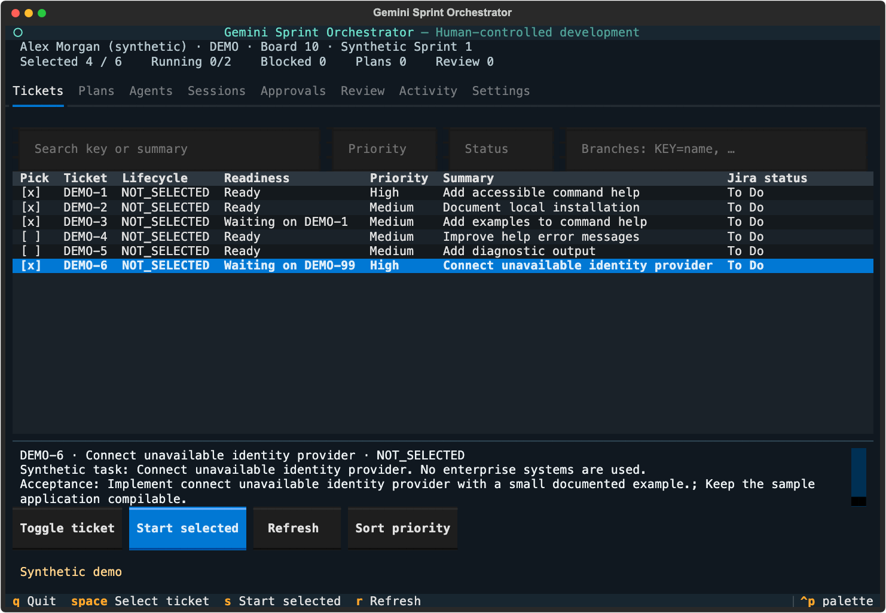

# Gemini Sprint Orchestrator

Pick your assigned Jira tickets, see which are ready and which wait on others, and let Gemini CLI work on each one in its own Git worktree — **planning first, coding only after you approve the plan**.

```
tickets ──► work ──► Gemini plans (read-only) ──► you approve / comment / reject ──► Gemini implements ──► you review & accept
```

**Version 0.5.1 is an MIT-licensed public alpha.** The offline demo is the supported starting point. Connected Gemini/Jira configurations need validation on your approved work system; this is not an enterprise security certification. See [release readiness](docs/release-readiness.md) and [known limitations](docs/limitations.md).



## Try it in one minute (offline demo)

Python 3.11+ and Git on macOS or Linux (Linux also needs `bubblewrap`):

```sh
git clone https://github.com/bzlatin/gemini-sprint-orchestrator.git
cd gemini-sprint-orchestrator
python3 -m venv .venv && source .venv/bin/activate
python -m pip install -c requirements.lock -e .
gemini-orchestrator demo
```

Prefer to let Gemini do the install? See [Install or update with Gemini CLI](#install-or-update-with-gemini-cli).

The demo uses synthetic tickets and a sample repository; no Gemini, Jira, credentials or network.

1. **Tickets** — Space selects tickets. The *Readiness* column shows `Ready` or `Waiting on KEY`. Optionally type branch names (`KEY=name`) in the branch field.
2. **Start selected** — one confirmation shows every branch name, dependency and check. Gemini then drafts a read-only implementation plan for each ready ticket.
3. **Plans** — load a plan and read it. **Approve plan** lets Gemini implement it; **Send comment** asks Gemini to revise it; **Reject plan** stops the ticket and keeps its worktree.
4. **Review** — inspect the real diff and verification, then accept (a local commit on the ticket branch) or request changes.
5. Tickets waiting on a prerequisite become `Ready` once you accept it; start them the same way.

## The same flow from the CLI

```sh
gemini-orchestrator tickets                         # readiness of your sprint tickets
gemini-orchestrator work APP-1 APP-2 --branch APP-1=feature/login
gemini-orchestrator plan APP-1                      # read Gemini's plan
gemini-orchestrator plan APP-1 --comment "Reuse the existing session store"
gemini-orchestrator plan APP-1 --approve            # Gemini implements the approved plan
gemini-orchestrator review APP-1 --accept
gemini-orchestrator status                          # every ticket's next step
```

Use `--profile demo` with the demo. A connected profile contacts Jira or Gemini only after you allow it once (during setup, or `gemini-orchestrator profile connected --enable`); until then, add `--enable-connected` per command. `gemini-orchestrator --help` lists the core workflow first; everything else is under *Advanced*.

## Branch names

Branches come from a template you set during `setup` (default `{type}/{key}-{slug}`, e.g. `feature/APP-12-add-login` or `fix/APP-7-crash-on-empty-input`). Fields: `{key}`, `{slug}` (summary), `{type}` (`fix` for bugs, otherwise `feature`), `{id}` (short schedule id). You see and approve every name before work starts, and can override any of them. Protected and existing branches are refused.

## Safety model

- **You approve every consequential step:** starting work, each implementation plan, accepting code, and any optional push or draft PR. Approvals are bound to exact fingerprints; if the plan, ticket, worktree or settings change, approval is required again.
- **Planning cannot edit code.** The planning turn runs with read-only tools and an OS sandbox that denies writes to the worktree; a changed worktree fails planning.
- **Workers are sandboxed** (`sandbox-exec` on macOS, `bubblewrap` on Linux): only local read/edit tools, no shell, MCP, web or delegation; scrubbed environment; isolated provider home; one worktree per ticket.
- **Jira is read-only.** Only exact known read tools are allowed; ticket content is passed to Gemini as untrusted data.
- **Nothing leaves your machine without a separate approval.** No telemetry, Jira writes, automatic merges, pushes, deployments or worktree deletion.

Details: [security](docs/security.md), [hardening](docs/hardening.md), [security policy](SECURITY.md).

## Connected setup

On an approved work system, run setup from inside the repository you want to work in:

```sh
cd path/to/your-project
gemini-orchestrator setup          # a few questions: name, repo, branch naming, Jira, access, checks
gemini-orchestrator jira test
gemini-orchestrator start
```

Setup detects the repository, a worktree folder next to it, your Gemini CLI, the Jira server in your Gemini MCP settings and suggested checks. You confirm your Jira account, board and sprint yourself, and allow the profile to contact Jira and Gemini from this machine once (turn it off any time with `profile connected --disable`), and can change any default (team, hosting, concurrency, timeouts, plan-first) from the summary before saving. It finishes with local diagnostics; `doctor` reruns them.

Jira Cloud, Server and Data Center work through supported MCP tools; direct REST is Jira Cloud only. See [integration compatibility](docs/integrations.md) and [enterprise deployment](docs/enterprise.md). Gemini runs with an isolated home; authenticate it once per ticket home as described in [hardening](docs/hardening.md).

## Updating

New versions are listed in the [changelog](CHANGELOG.md). Read it before updating: it calls out breaking changes and anything you need to redo (0.5.0, for example, renames `plan` to `schedule` and needs in-progress work started again).

1. Quit the dashboard; this also stops its workers. Note any tickets you are mid-review on.
2. Optionally back up your local data folder (`~/.local/share/gemini-orchestrator`, or `GSO_HOME`). Databases are not migrated automatically.
3. Update the checkout and its dependencies:

```sh
cd gemini-sprint-orchestrator
git pull
source .venv/bin/activate
python -m pip install -c requirements.lock -e .
gemini-orchestrator doctor
```

To stay on a specific release instead of the latest `main`, check out its tag (for example `git checkout v0.5.1`) in place of `git pull`. Worktrees, branches and accepted commits are never deleted by an update.

## Install or update with Gemini CLI

Copy one of these prompts into Gemini CLI in a terminal. Gemini asks before each command it runs; read each one before allowing it. Gemini only installs or updates the tool. It never runs `setup` for you, because setup is where you confirm your Jira account and which commands may run on your code. If Gemini or its model is unavailable, use the manual steps above.

<details>
<summary>Install prompt</summary>

```text
Install the open-source "gemini-sprint-orchestrator" tool for me. Follow these rules:
- Explain each shell command before running it and wait for my approval. Never use sudo
  without asking me first.
- Do not read, print, copy or edit credentials, tokens, ~/.gemini settings, or any files
  under ~/.local/share/gemini-orchestrator.
- If a step fails, stop and tell me the exact error and the likely fix. Do not work around
  failures by skipping checks.

Steps:
1. Check that git and Python 3.11 or newer are installed. On Linux, also check that
   `bwrap --version` works; if it does not, tell me the package to install (bubblewrap).
2. Ask me where to install it (suggest ~/tools). Clone
   https://github.com/bzlatin/gemini-sprint-orchestrator.git there.
3. In the clone, create a virtual environment with `python3 -m venv .venv`, then run
   `.venv/bin/python -m pip install -c requirements.lock -e .`.
4. Verify with `.venv/bin/gemini-orchestrator test` and `.venv/bin/gemini-orchestrator
   --home "$(mktemp -d)" demo --headless`.
5. Ask whether I want the command on my PATH. If yes, and ~/.local/bin is on PATH, create a
   symlink from ~/.local/bin/gemini-orchestrator to the .venv/bin/gemini-orchestrator file.
6. Finish by telling me to run `gemini-orchestrator demo` to try it, and to run
   `gemini-orchestrator setup` myself from inside my project's repository. Do not run setup.
```

</details>

<details>
<summary>Update prompt</summary>

```text
Update my existing "gemini-sprint-orchestrator" installation. Follow these rules:
- Explain each shell command before running it and wait for my approval.
- Do not read, print, copy or edit credentials, tokens, ~/.gemini settings, or any files
  under ~/.local/share/gemini-orchestrator. Never delete worktrees or branches.
- If a step fails, stop and tell me the exact error and the likely fix.

Steps:
1. Ask me where it is installed (look for a gemini-sprint-orchestrator clone, e.g. in ~/tools).
2. Make sure the gemini-orchestrator dashboard is not running (ask me to quit it if it is).
3. In the clone, run `git status`. If there are local changes, stop and ask me what to do.
4. Run `git fetch --tags`, show me the CHANGELOG.md entries newer than my current version
   (shown in src/gemini_orchestrator/__init__.py), and
   summarize any breaking changes or steps I must redo.
5. After I confirm, run `git pull`, then
   `.venv/bin/python -m pip install -c requirements.lock -e .`.
6. Verify with `.venv/bin/gemini-orchestrator test` and `.venv/bin/gemini-orchestrator doctor`,
   and report the results.
```

</details>

## More

- [User guide](docs/guide.md) · [sessions and VS Code](docs/sessions.md) · [architecture](docs/architecture.md)
- [Recorded demo walkthrough](docs/demo/README.md) · [changelog](CHANGELOG.md)

## Development

```sh
python -m pip install -c requirements-dev.lock -e '.[dev]'
python -m pytest
ruff check . && ruff format --check .
mypy src/gemini_orchestrator
python scripts/demo_walkthrough.py --output /tmp/new-walkthrough-dir
```
