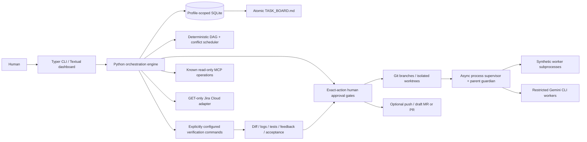

# Architecture

The application is a local process, not a service. Each profile owns configuration and runtime data. Identity, repository, board and sprint form a state scope; changing these opens a separate session database without deleting previous work. An OS advisory lock prevents two coordinators from supervising the same scope.

Pydantic validates configuration and tickets. SQLite transactions guard state transitions and audit events; approval rows identify exact action, subject and SHA-256 fingerprint. The planner builds confirmed dependency edges, detects cycles with a deterministic topological pass, and separates overlapping declared paths. Mention-based recommendations remain advisory. Groups respect concurrency.

Workers run in dedicated worktrees. A process guardian watches coordinator parentage and terminates its process group if the parent disappears. The coordinator captures stdout/stderr to local files, enforces timeouts and bounds retries. Restart marks unfinished tasks INTERRUPTED and requires human inspection and a fresh plan. Native Gemini session continuity is not assumed; ticket context and feedback are supplied again in the existing worktree.

Verification is a sequence of explicit argv arrays, never implicit shell strings. Results contain commands, durations, exit codes, timeout status and local log paths. Review approval fingerprints tracked and untracked content, symlink targets and file modes. Acceptance creates a local commit with hooks disabled, enabling dependent work to use accepted prerequisite commits. Divergent prerequisites require manual integration; the application never merges them.

Textual uses asyncio workers so process execution does not block interaction. The Markdown board is generated from SQLite and replaced atomically. No completion percentages are synthesized.

Schema version 1 is checked at database open. Unknown schema versions are rejected. Back up configuration and runtime before upgrading; automatic schema migration is not yet implemented.
