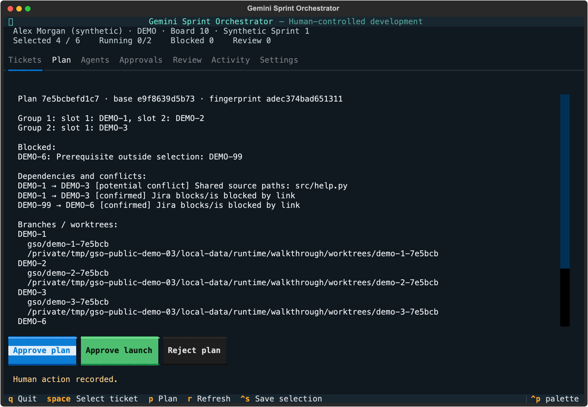
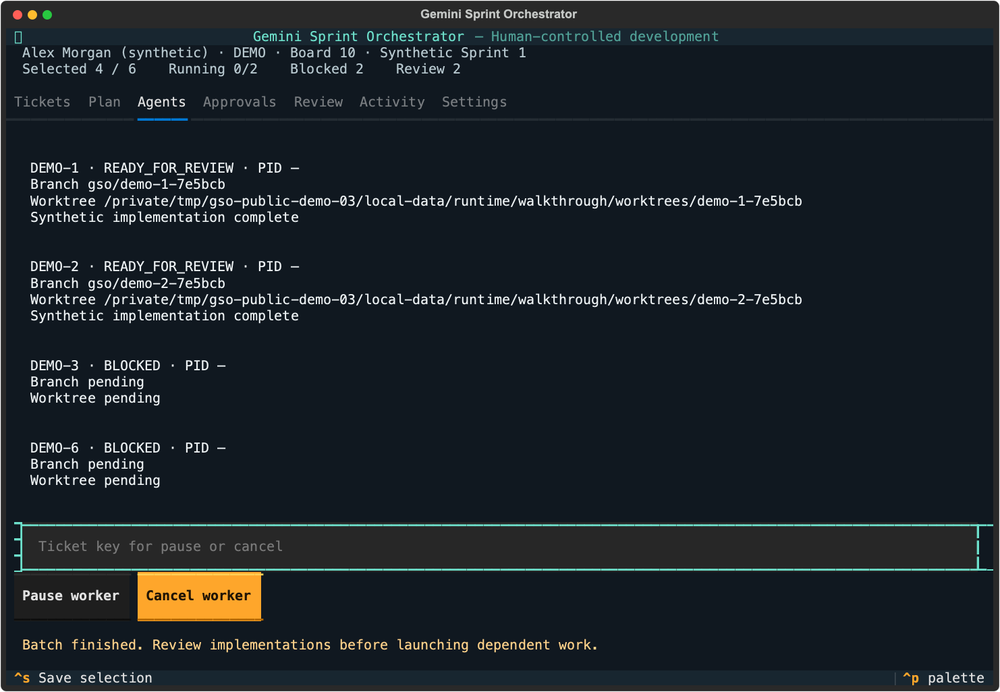
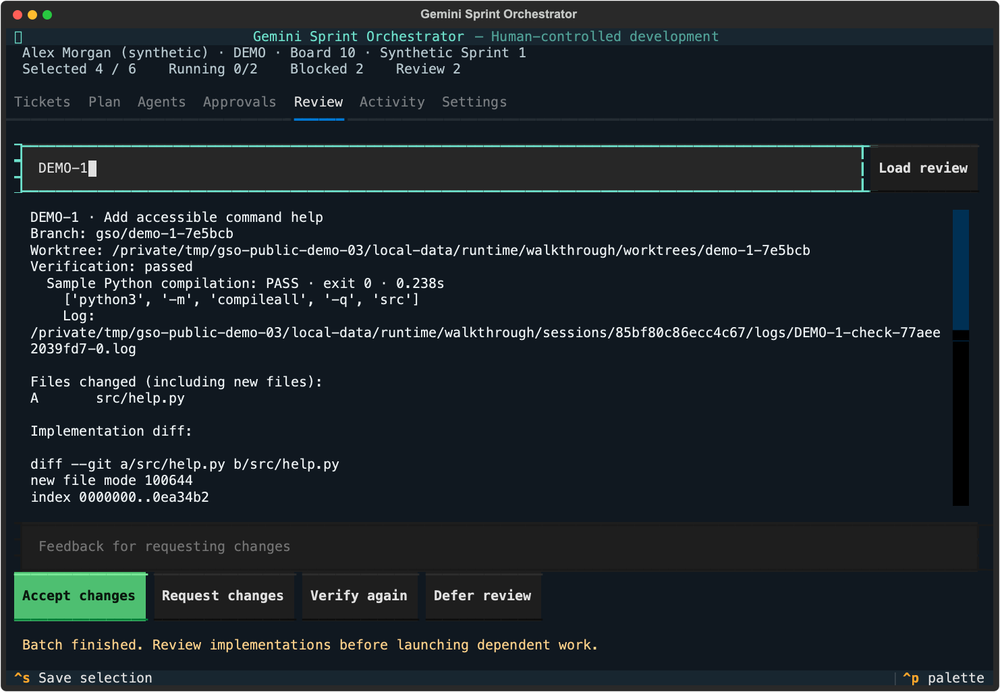
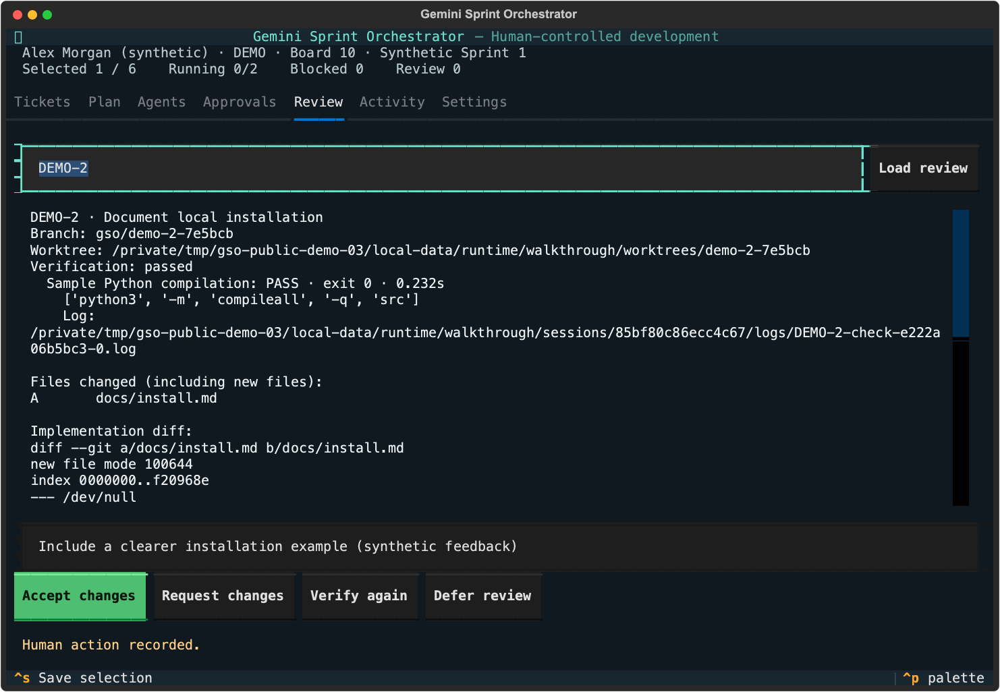

# Scripted synthetic demo walkthrough

This walkthrough ran the actual Textual application with scripted test-operator button/key interactions. It did not contact Jira, invoke a model account or write to a remote repository. It uses the same durable approval and execution paths as the interactive demo; the harness is a developer test, not a product API for agents to approve work.

The [machine-readable report](report.json) records the actual steps and final states:

1. Discovered six synthetic tickets and selected four through the explorer.
2. Confirmed selection and inspected the deterministic execution plan.
3. Approved the plan; verified that this alone launched no workers.
4. Separately approved launch. Independent workers finished in real worktrees; DEMO-3 and DEMO-6 remained blocked.
5. Loaded and accepted verified prerequisite implementations through review confirmations.
6. Approved a fresh launch for dependent DEMO-3; verified and accepted it.
7. Requested a change to DEMO-2, reselected it and approved a new plan/launch. The worker continued in its original worktree; its earlier logs were preserved.
8. Accepted the continuation, closed the app, reloaded the saved profile and reopened SQLite state. Accepted states and feedback survived.

The run recorded 11 granted approval records. DEMO-1/2/3 finished APPROVED. DEMO-4/5 remained unselected. DEMO-6 was explicitly deselected when the later continuation selection was saved; its earlier blocked state is recorded in the report.

Captures are native Textual SVG exports, rendered locally with a system monospaced font. External web-font declarations were removed. Content is synthetic, including identities, ticket keys and temporary paths. PNG captures were visually inspected; full SSH/tmux and assistive-technology behavior remains target-system validation work.

Reproduce with `python scripts/demo_walkthrough.py --output /tmp/new-synthetic-demo-directory` after installing development dependencies. The output directory must be new so old evidence is preserved. The normal user demo remains `gemini-orchestrator demo` with interactive confirmations.
