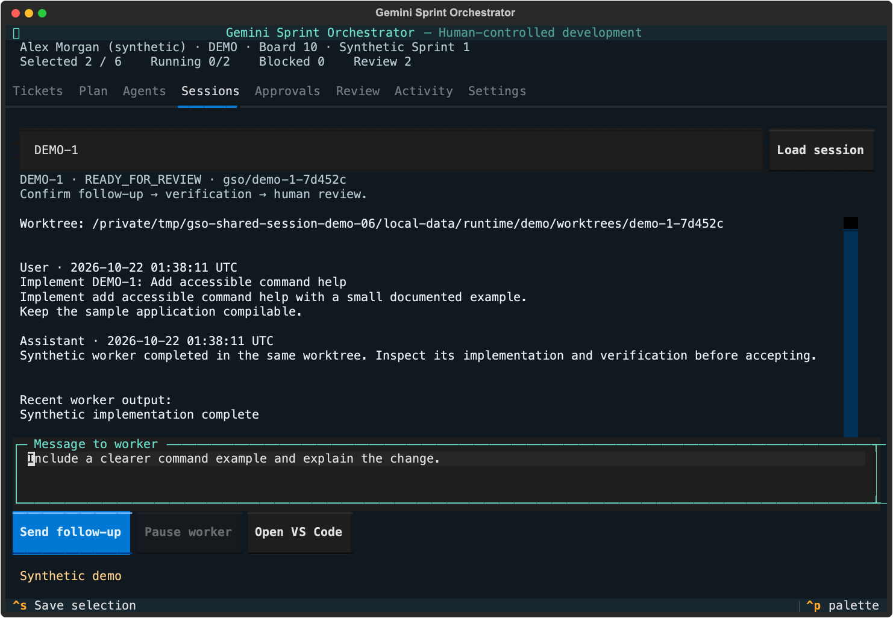
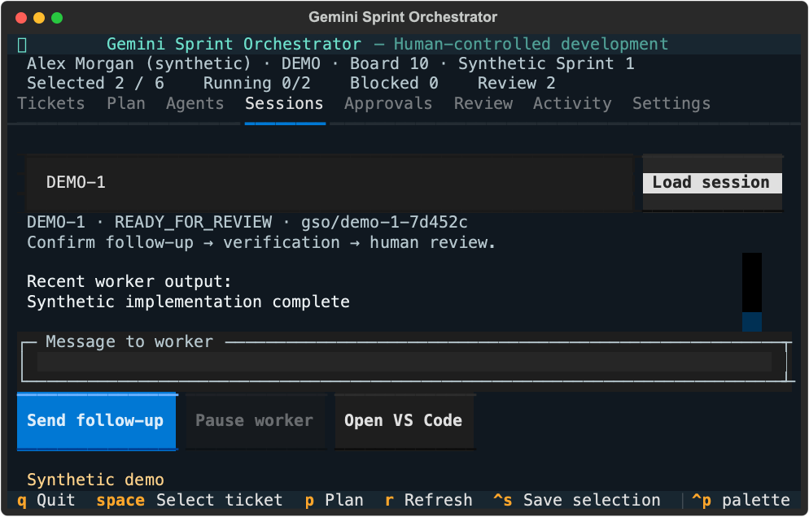
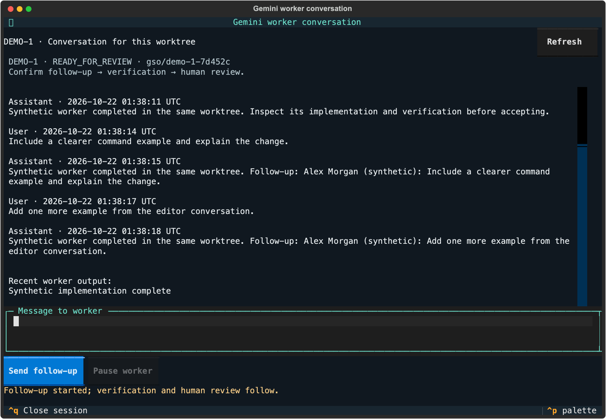
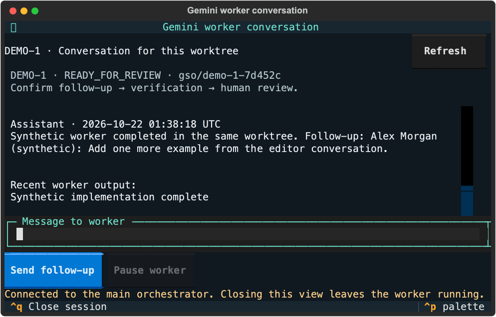
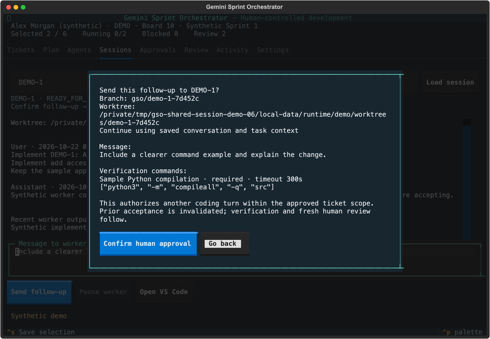

# Shared-session walkthrough

The [report](report.json) records an actual synthetic walkthrough of the dashboard and the shared terminal application used by the generated VS Code task. No model account or company service was contacted.

The walkthrough declined one message and preserved its draft, sent a confirmed dashboard follow-up, sent a second confirmed message through the editor-terminal application, observed that reply in the main dashboard, verified the same branch/worktree and passing checks, and reopened persistent state with all six conversation entries intact. Both views were exercised at 120×40 and 80×24.

VS Code is not installed on this development machine. Its executable launch was stubbed; the generated workspace, process-task arguments and working directory were inspected. The actual conversation client that task runs was exercised through Textual. These captures show terminal UI, not an installed VS Code window. The native-session test separately runs a real sandboxed synthetic Gemini executable and asserts exact UUID resumption; real provider authentication/history compatibility remains target-system validation.











Reproduce after installing development dependencies:

```sh
python scripts/demo_sessions.py --output /tmp/new-shared-session-demo
```

Captures are native Textual SVG exports rendered locally with system monospaced fonts. No external font requests are included. All content, paths and identities are synthetic.
